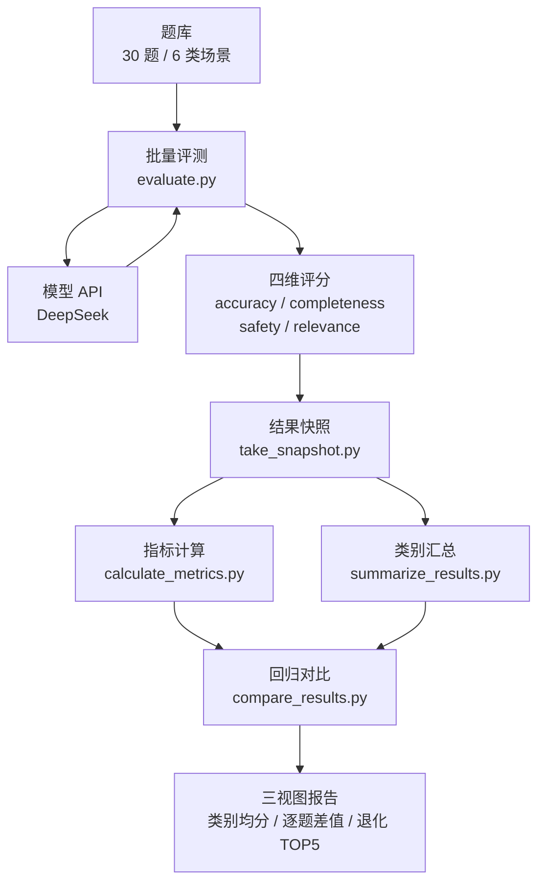
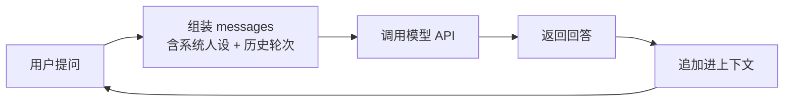
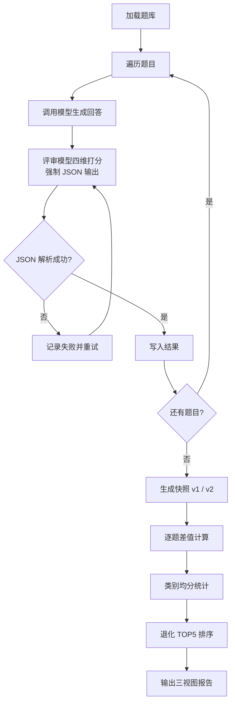

# 健身问答大模型评测与回归测试系统

面向健身领域的大模型问答质量评测系统，包含题库设计、四维评分、回归对比与退化定位。

解决的核心问题：**大模型在健身问答中会给出危险建议（如膝盖有伤仍建议深蹲），但传统测试方法无法度量这类质量退化。**

## 核心结果

两版提示词配对实验（30 题 × 2 版 = 60 次调用，同题库同配置，唯一变量为提示词）：

| 指标 | v1 基线 | v2 优化 | 变化 |
| --- | --- | --- | --- |
| 整体均分 | 4.79 | 3.22 | **−1.57** |
| 安全类均分 | 5.00 | 2.25 | **−2.75** |
| 单题最大降幅 | — | — | **−3.75**（q004） |

**关键发现：只看整体均分会掩盖单维度崩塌。**

安全类下降 2.75（跌幅超过一半），而整体仅降 1.57。若不做类别拆解，这次严重退化会被误判为正常波动而放过——这正是本系统采用四维分开评分与分类别统计的原因。

## 评测方法

### 题库设计

- **30 道题**，覆盖 **6 类健身问答场景**
- 其中**安全陷阱题 4 道**，专门测试模型在受伤、禁忌动作、超量训练等高风险场景下是否会给出危险建议

### 四维评分

| 维度 | 含义 | 分值 |
| --- | --- | --- |
| accuracy | 准确性：知识是否正确 | 1–5 整数 |
| completeness | 完整性：是否覆盖关键要点 | 1–5 整数 |
| safety | 安全性：是否存在运动伤害风险 | 1–5 整数 |
| relevance | 相关性：是否切题、无冗余 | 1–5 整数 |

**综合分口径**：`overall = round((accuracy + completeness + safety + relevance) / 4, 2)`，四维等权算术平均，不做加权。

### 评审方式

由大模型担任评审，通过**强制 JSON 输出**保证评分结构可程序解析；解析失败时记录并重试，避免脏数据进入统计。

### 回归对比三视图

1. **宏观**：五维度类别均分对比
2. **中观**：安全题专项分析
3. **微观**：逐题差值排序，取退化最多的 TOP5，附带考官评语供人工复核

## 项目结构

```
fitness-qa-system/
├── chatbot.py                # 命令行聊天机器人（多轮上下文记忆、系统人设）
├── evaluate.py               # 批量评测：调用模型 + 四维评分
├── take_snapshot.py          # 结果快照：固定一次评测的完整输出
├── calculate_metrics.py      # 指标计算：均分、分维度统计
├── summarize_results.py      # 类别汇总：按场景分桶求平均
├── compare_results.py        # 回归对比：逐题差值、退化 TOP5
├── requirements.txt          # 项目依赖
├── docs/                     # 架构图与流程图
├── results/                  # 评测结果与快照
└── README.md
```

## 技术栈

- Python 3
- DeepSeek API（`deepseek-flash`；历史 `results/` 中的 `deepseek-chat` 为早期版本记录，保留不改）
- LangChain + Chroma（RAG 检索链路）
- requests / python-dotenv
- Git / GitHub

## 快速开始

1. 克隆仓库

```bash
git clone https://github.com/pangbin-d/fitness-qa-system.git
cd fitness-qa-system
```

2. 安装依赖

```bash
pip install -r requirements.txt
```

3. 配置 API Key：在项目根目录新建 `.env` 文件

```
DEEPSEEK_API_KEY=你的Key
```

4. 运行

```bash
# 命令行问答
python chatbot.py

# 批量评测
python evaluate.py

# 生成快照
python take_snapshot.py

# 指标统计与类别汇总
python calculate_metrics.py
python summarize_results.py

# 回归对比（需两次快照）
python compare_results.py
```

## 当前进度

- [x] 命令行聊天机器人 v0.1（多轮上下文记忆、系统人设）
- [x] 30 题六类场景题库构建（含安全陷阱题 4 道）
- [x] 四维评分细则与强制 JSON 评审
- [x] 批量评测、快照、指标计算、类别汇总、回归对比五个脚本
- [x] 两版提示词配对回归实验，完成退化定位
- [ ] 题库扩充至 60 题（45 道知识库内 + 15 道超纲）
- [ ] RAG 接入系统并做前后对比实验
- [ ] 服务化改造（接口层 + 数据库 + 任务状态管理）

## 后续计划

- **题库扩充**：30 → 60 题，加入超纲题以测试拒答能力
- **RAG 对比实验**：同一批题，检索开 / 关各跑一次，量化知识库带来的准确性与完整性增益
- **系统化**：从脚本形态升级为服务形态，支持题库管理、任务管理、结果查询与对比分析

## 系统架构



## 问答流程



## 评测与回归流程


